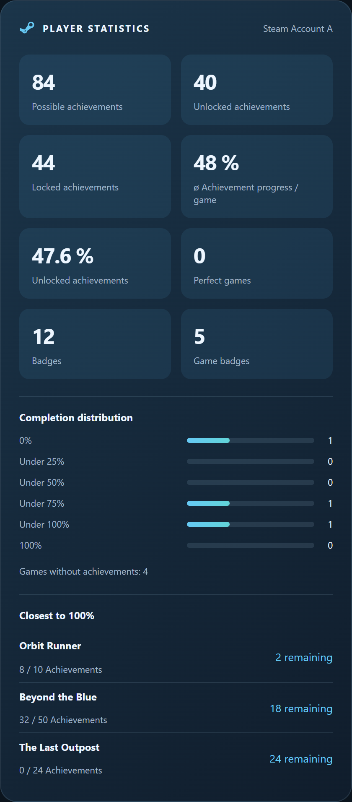
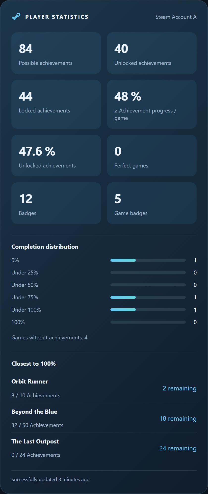
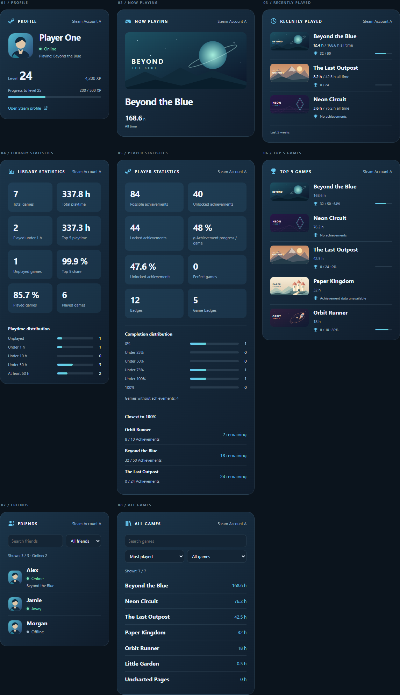
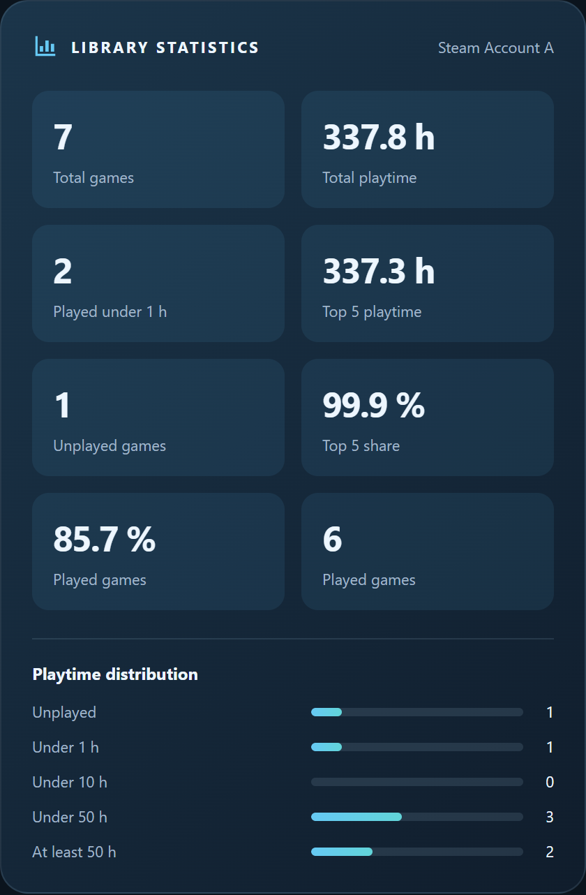

# Steam Tracker Card companion

[**Steam Tracker Card**](https://github.com/lefidelity/steam-tracker-card) is a
separate frontend project named `steam-tracker-card`.
It provides profile, current game, recently played, library statistics, player
statistics, top-five games, friends, and full-library views. Detailed, compact,
and single-line layouts are available. Friends and the full library include
search and filtering or sorting. A visual editor selects the account, view, layout, appearance,
language, and display options. Multiple cards can be combined into a dashboard.

Integration 0.9.8 and card 0.9.8 extend player statistics with the
overall achievement rate, locked achievement count, six exact completion groups,
and up to five completion candidates, without additional Steam requests. Detailed
and compact layouts show the additions; single-line retains its original metrics.
Games without achievements are separate, and older sensors retain their existing
display. Both 0.9.8 updates are required; version 0.9.5 alone does
not supply the new attributes.


The editor can independently hide the upper-right account label and the title,
preserving any custom title. Offline profiles show a relative last-online time
below their status in detailed and compact layouts when `lastlogoff` is available.
Online players with a current game see “Playing: <game name>” there instead,
using the same account's existing current-game sensor without extra Steam requests.

In version 0.9.5, the full-library view adds played/unplayed
and exact playtime-range filters, with default sorting and filtering in the editor.
Game and friend names support configurable Steam links or sensor-detail actions;
the default is no action. Full-library Steam links and playtime filters use the
new `appid` and `playtime_minutes` fields in `all_games`, requiring the integration
update to at least 0.9.5 alongside the card. Earlier integration versions lack these fields.
Existing data still supports searching, sorting, and sensor-detail actions.

Version 0.9.5 also adds **Show data freshness** in the editor
(`show_data_status: true`, disabled by default) for every view and layout.
It displays “Successfully updated 3 minutes ago” from the integration's new
`last_successful_update` attribute, using the oldest timestamp when several
sources contribute. The tooltip gives the absolute time. Missing, invalid,
future, unknown, or unavailable sources hide the display; Home Assistant state
timestamps are never substituted. The relative text updates locally each minute.
The attribute requires integration 0.9.5 or newer; update both projects.
The integration shares status/current-game summaries for up to 15 seconds per
account. A cache hit preserves the actual summary fetch timestamp, so the
footer does not claim a new fetch when data was reused.



Library bars now label the inclusive final group **At least 50 h** / **ab 50 h**.
Tooltips clarify **1 to under 10 hours** and **10 to under 50 hours**, with matching
German text and accessible labels. The exact-minute boundaries are unchanged.



[Visual guide: all card views and variants](steam_tracker_card_visual_guide.md).
Compare [Steam blue / English](steam_tracker_card_visual_guide/steam-en.md),
[Home Assistant theme / English](steam_tracker_card_visual_guide/theme-en.md),
[Steam blue / German](steam_tracker_card_visual_guide/steam-de.md), and
[Home Assistant theme / German](steam_tracker_card_visual_guide/theme-de.md).
Every view has Full, Compact, and Single line images. The Home Assistant theme
uses a light reference theme; the card inherits your own theme colors at runtime.

The card reads the existing sensors and attributes. It does not make Steam API
requests, need a Steam API key, or require button-card, bar-card, or card-mod.
Library statistics now include played percentage, unplayed games, top-five
playtime share, and a five-group playtime distribution when the updated
integration provides those attributes. Older sensor data keeps the original
statistics; detailed and compact layouts show the distribution bars.
The card uses view-specific heading icons, separators and top-aligned artwork
for recent/top-five games, and the revised library tile order and distribution labels.



It identifies registered sensors using the `steam_tracker` platform and their
existing unique IDs. Account devices are available from integration 0.6.0;
older registered entities can be grouped by config entry. Manual
assignments support legacy YAML sensors and users without registry access.

The local project is at `../steam-tracker-card` relative to this repository and
contains English/German installation instructions, `dist/steam-tracker-card.js`,
an interactive preview, and automated logic/browser checks. The GitHub repository
is [lefidelity/steam-tracker-card](https://github.com/lefidelity/steam-tracker-card).
HACS validation and tests in a real Home Assistant instance are still pending.
The current source version is 0.9.9 for both projects; install and update
them separately. No GitHub release is published for 0.9.9.
Library additions require integration 0.7.1 or newer;
profile details use existing status and current-game attributes.

See the card's [installation instructions](https://github.com/lefidelity/steam-tracker-card#installation)
for HACS custom repository and manual installation steps.

## Configuration examples

These are small card configurations, not complete dashboards. Install the
companion card first. It is optional; for custom cards and automations, use the
[English sensor reference](sensors_en.md) or [German sensor reference](sensors_de.md).

### One view

With one discovered account, automatic assignment is sufficient:

```yaml
type: custom:steam-tracker-card
view: player_stats
layout: detailed
language: en
```

Use `profile`, `current_game`, `recent_games`, `library_stats`, `player_stats`,
`top_games`, `friends`, or `games`. Layouts are `detailed`, `compact`, and
`single_line`. The visual editor can select these options without YAML.

### Two accounts

Select each account in its card's visual editor. The editor writes the account
identifier; the example values below are placeholders, not Steam IDs or account
display names. Replace them with the values produced by your editor:

```yaml
type: vertical-stack
cards:
  - type: custom:steam-tracker-card
    view: profile
    account: ACCOUNT_DEVICE_ID_A
    language: en
  - type: custom:steam-tracker-card
    view: profile
    account: ACCOUNT_DEVICE_ID_B
    language: en
```

### Manual sensor assignment

For renamed entities or unavailable account discovery, assign the actual entity
ID from Home Assistant. Assign every override to the intended account:

```yaml
type: custom:steam-tracker-card
view: player_stats
layout: compact
language: en
entities:
  global_stats: sensor.steam_tracker_global_stats
```

No API key belongs in any card configuration. Version 0.9.5 shows its existing
statistics; the additional player statistics require integration 0.9.8 and card
0.9.8 as described above.

## Repository names

Use **Steam Tracker** / `steam-tracker` for the integration and
**Steam Tracker Card** / `steam-tracker-card` for the card. A `hacs-` prefix is not
needed; HACS is a distribution method. The card has an independent
Git repository with its own version.

The integration repository is [lefidelity/steam-tracker](https://github.com/lefidelity/steam-tracker).
Documentation, manifest links,
the HACS installation link, and the local Git remote use the new repository name.
The integration domain remains `steam_tracker`; the repository name does not
require changing sensor IDs or attributes.

## Deutsche Kurzfassung

Integration 0.9.8 und Karte 0.9.8 ergänzen die Spieler-Statistik
um Gesamt-Erfolgsquote, gesperrte Erfolge, sechs Abschlussgruppen und bis zu fünf
Abschlusskandidaten. Zusätzliche Steam-Abfragen sind nicht nötig. Ausführliche
und kompakte Darstellung zeigen die Ergänzungen; der Einzeiler behält seine
bisherigen Kennzahlen. Spiele ohne Erfolge stehen separat. Ältere Sensoren
behalten ihre bisherige Darstellung; beide Updates auf 0.9.8 sind erforderlich.
Version 0.9.5 allein liefert die neuen Attribute nicht.

Die separate **Steam Tracker Card** bietet Profil, aktuelles Spiel, kürzlich
gespielte Spiele, Bibliothek-Statistik, Spieler-Statistik, Top-5-Spiele, Freunde
und die Spiele-Gesamtübersicht. Die Darstellungen Ausführlich, Kompakt und
Einzeiler sind verfügbar; Freunde und Spiele besitzen Suche und Filter
beziehungsweise Sortierung. Im visuellen Editor lassen sich Konto und Ansicht
sowie Darstellung, Sprache und weitere Optionen auswählen. Die Karte liest
vorhandene Sensoren und benötigt weder einen API-Key noch weitere Custom Cards.
Kontoname rechts oben und Titel lassen sich getrennt ausblenden; ein eigener
Titel bleibt gespeichert. Offline-Profile zeigen in Ausführlich und Kompakt die
letzte Onlinezeit unter dem Status, sofern `lastlogoff` verfügbar ist.
Bei online verbundenen Spielern mit laufendem Spiel steht dort stattdessen
„Spielt: <Spielname>“, aus dem vorhandenen Spielsensor desselben Kontos.

Version 0.9.5 ergänzt die Spiele-Gesamtübersicht um Filter für
gespielte und ungespielte Spiele sowie genaue Spielzeitbereiche. Standardfilter
und Standardsortierung sind im Editor wählbar. Ein Klick auf Spiel- oder
Freundesnamen kann Steam oder die zugehörigen Sensordetails öffnen; standardmäßig
bleibt die Aktion deaktiviert. Die neuen Bibliotheksfilter und Steam-Links nutzen
`appid` und `playtime_minutes` aus `all_games`; dafür muss auch die Integration
auf mindestens 0.9.5 aktualisiert werden. Ältere Integrationen liefern diese Felder nicht. Suche, Sortierung und Sensordetails funktionieren auch mit älteren Daten.

Optional lässt sich mit **Datenstand anzeigen** (`show_data_status: true`) in
allen Ansichten der letzte erfolgreiche Abruf einblenden. Dafür ist Integration
0.9.5 erforderlich. Cache-Treffer behalten den ursprünglichen Abrufzeitpunkt.
Die letzte Spielzeitgruppe heißt **ab 50 h**; Tooltips erklären die genauen Grenzen.

Die [Bild-Dokumentation](steam_tracker_card_visual_guide.md) zeigt alle acht
Ansichten in Steam-Blau und Home-Assistant-Theme, Deutsch und Englisch sowie
Voll, Kompakt und Einzeilig: insgesamt 96 Einzelbilder. Direkt zu den deutschen
Vergleichen für [Steam-Blau](steam_tracker_card_visual_guide/steam-de.md) und
[Home-Assistant-Theme](steam_tracker_card_visual_guide/theme-de.md).
Die Gesamtübersicht darüber zeigt Steam-Blau, Voll und Englisch.

Die Bibliothek-Statistik ergänzt Spielquote, ungespielte Spiele, Top-5-Anteil und
eine Spielzeit-Verteilung in fünf Gruppen, sobald die aktualisierte Integration
die Attribute liefert. Ausführlich und Kompakt zeigen die Verteilung als Balken;
ältere Sensordaten behalten die bisherige Darstellung. Die Karte nutzt passende
Titelsymbole, Trennlinien und oben bündige Bilder für kürzlich gespielte und
Top-5-Spiele sowie die neue Kachelreihenfolge und Verteilungsbeschriftung.

Das lokale Git-Projekt liegt neben dieser Integration im Ordner
`steam-tracker-card`. Vorschau, deutsche Anleitung und Prüfungen sind dort
enthalten. Das GitHub-Repository ist
[lefidelity/steam-tracker-card](https://github.com/lefidelity/steam-tracker-card).
Die [deutsche Installationsanleitung](https://github.com/lefidelity/steam-tracker-card/blob/main/docs/README_de.md#installation)
beschreibt HACS und die manuelle Installation. HACS-Validierung und Tests in einer
echten Home-Assistant-Instanz stehen noch aus.

Für beide Projekte wird kein `hacs-`-Präfix benötigt. Das Integrationsrepository
heißt auf GitHub `lefidelity/steam-tracker`; Dokumentation, Manifest, HACS-Link
und lokales Git-Remote verwenden diesen Namen. Die Integration erscheint als
Quellcode-Version 0.9.9, die Karte ebenfalls als 0.9.9; beide werden separat
installiert. Für 0.9.9 wird kein GitHub-Release veröffentlicht.
Die technische Domain bleibt
`steam_tracker`; eine Änderung der Sensor-IDs ist für den Repository-Namen nicht nötig.

## Kleine Konfigurationsbeispiele

Diese Beispiele sind einzelne Karten beziehungsweise ein kleiner Kartenstapel,
keine vollständigen Dashboards. Zuerst die Companion Card installieren. Sie bleibt
optional: Für eigene Karten und Automationen gibt es die
[deutsche Sensorreferenz](sensors_de.md) und die [englische Referenz](sensors_en.md).

### Eine Ansicht

Bei einem erkannten Konto genügt die automatische Zuordnung:

```yaml
type: custom:steam-tracker-card
view: player_stats
layout: detailed
language: de
```

Ansichten: `profile`, `current_game`, `recent_games`, `library_stats`,
`player_stats`, `top_games`, `friends`, `games`. Darstellungen: `detailed`,
`compact`, `single_line`. Diese Auswahl bietet auch der visuelle Editor.

### Zwei Konten

Jedes Konto im visuellen Editor seiner Karte auswählen. Der Editor schreibt die
Konto-ID; die folgenden Werte sind Platzhalter, keine Steam-IDs oder Anzeigenamen.
Durch die vom Editor erzeugten Werte ersetzen:

```yaml
type: vertical-stack
cards:
  - type: custom:steam-tracker-card
    view: profile
    account: ACCOUNT_DEVICE_ID_A
    language: de
  - type: custom:steam-tracker-card
    view: profile
    account: ACCOUNT_DEVICE_ID_B
    language: de
```

### Sensor manuell zuweisen

Für umbenannte Entitäten oder fehlende automatische Kontozuordnung die
tatsächliche Entity-ID aus Home Assistant verwenden. Jede manuelle Zuordnung
muss zum beabsichtigten Konto gehören:

```yaml
type: custom:steam-tracker-card
view: player_stats
layout: compact
language: de
entities:
  global_stats: sensor.steam_tracker_global_stats
```

API-Keys gehören nicht in die Kartenkonfiguration. Version 0.9.5 zeigt ihre
bisherigen Statistiken; die zusätzlichen Spielerstatistiken benötigen die oben
beschriebenen Updates von Integration und Karte auf 0.9.8.
