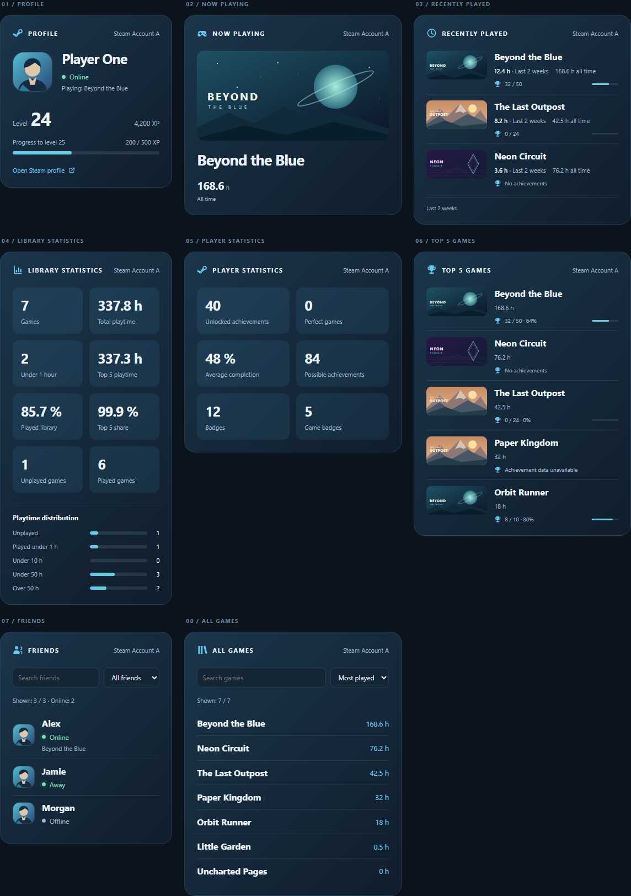

# Steam Tracker Card visual guide

All eight views in both appearances and languages, with all three layouts:
**96 individual card images**, plus one **Steam blue / Full / English** overview.

## Choose an appearance and language

| Appearance | English | German |
| --- | --- | --- |
| Steam blue | [English gallery](steam_tracker_card_visual_guide/steam-en.md) | [German gallery](steam_tracker_card_visual_guide/steam-de.md) |
| Home Assistant theme | [English gallery](steam_tracker_card_visual_guide/theme-en.md) | [German gallery](steam_tracker_card_visual_guide/theme-de.md) |

Each gallery compares Full, Compact, and Single line next to one another.
Click any card image to open the full-resolution PNG.

## Find a view

| View | Steam blue / English | HA theme / English | Steam blue / German | HA theme / German |
| --- | --- | --- | --- | --- |
| Profile | [View](steam_tracker_card_visual_guide/steam-en.md#profile) | [View](steam_tracker_card_visual_guide/theme-en.md#profile) | [View](steam_tracker_card_visual_guide/steam-de.md#profile) | [View](steam_tracker_card_visual_guide/theme-de.md#profile) |
| Current game | [View](steam_tracker_card_visual_guide/steam-en.md#current-game) | [View](steam_tracker_card_visual_guide/theme-en.md#current-game) | [View](steam_tracker_card_visual_guide/steam-de.md#current-game) | [View](steam_tracker_card_visual_guide/theme-de.md#current-game) |
| Recently played | [View](steam_tracker_card_visual_guide/steam-en.md#recently-played) | [View](steam_tracker_card_visual_guide/theme-en.md#recently-played) | [View](steam_tracker_card_visual_guide/steam-de.md#recently-played) | [View](steam_tracker_card_visual_guide/theme-de.md#recently-played) |
| Library statistics | [View](steam_tracker_card_visual_guide/steam-en.md#library-statistics) | [View](steam_tracker_card_visual_guide/theme-en.md#library-statistics) | [View](steam_tracker_card_visual_guide/steam-de.md#library-statistics) | [View](steam_tracker_card_visual_guide/theme-de.md#library-statistics) |
| Player statistics | [View](steam_tracker_card_visual_guide/steam-en.md#player-statistics) | [View](steam_tracker_card_visual_guide/theme-en.md#player-statistics) | [View](steam_tracker_card_visual_guide/steam-de.md#player-statistics) | [View](steam_tracker_card_visual_guide/theme-de.md#player-statistics) |
| Top 5 games | [View](steam_tracker_card_visual_guide/steam-en.md#top-5-games) | [View](steam_tracker_card_visual_guide/theme-en.md#top-5-games) | [View](steam_tracker_card_visual_guide/steam-de.md#top-5-games) | [View](steam_tracker_card_visual_guide/theme-de.md#top-5-games) |
| Friends | [View](steam_tracker_card_visual_guide/steam-en.md#friends) | [View](steam_tracker_card_visual_guide/theme-en.md#friends) | [View](steam_tracker_card_visual_guide/steam-de.md#friends) | [View](steam_tracker_card_visual_guide/theme-de.md#friends) |
| All games | [View](steam_tracker_card_visual_guide/steam-en.md#all-games) | [View](steam_tracker_card_visual_guide/theme-en.md#all-games) | [View](steam_tracker_card_visual_guide/steam-de.md#all-games) | [View](steam_tracker_card_visual_guide/theme-de.md#all-games) |

## Reading the images

- Full corresponds to `layout: detailed`, Compact to `compact`, and Single line to `single_line`.
- Steam blue uses `appearance: steam`. Home Assistant theme uses `appearance: theme` and a light reference theme; it inherits your own dashboard colors in Home Assistant.
- The screenshot languages correspond to `language: en` and `language: de`.
- The individual cards use a consistent width of 420 CSS pixels and a 2x pixel ratio. Single-line headings are hidden by design; lists use one line per entry.
- The profile example is online and playing a game. Friends and the full library include their search and filter/sort controls.
- Images render the actual card component in the local preview with fictional accounts, games, and local artwork. Capturing them makes no Steam or external image requests.
- These previews document card 0.8.0. Live Home Assistant frontend and HACS installation checks remain separate from the preview.
